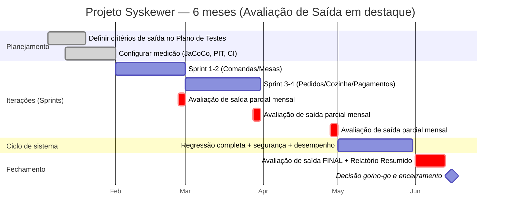

# Atividade 6 — Avaliação de Saída (*Test Completion*) · Syskewer API

> **Disciplina:** Testes de Software · **Tema do grupo:** nº 6 — *Avaliação de Saída*
> **Definição (CTFL 4.0):** checagem do atingimento dos **critérios de parada** e elaboração do **Relatório Resumido de Testes**.
> **Sistema sob teste:** Syskewer API (Java 21 · Spring Boot 3.3.1 · JWT · PostgreSQL)
> **Integrantes:** [Nome 1] · [Nome 2] · [Nome 3] · [Nome 4] · [Nome 5]

---

## 0. Resumo executivo (o "slide 1")

| Pergunta | Resposta |
|---|---|
| Os testes acabaram? | **Não podemos declarar encerramento.** Dos 8 critérios de saída: 3 atendidos, 2 parciais e 3 não atendidos. |
| Decisão recomendada | 🔴 **NO-GO para produção** · 🟡 *GO condicional* para a próxima iteração após corrigir os defeitos de severidade Alta (DEF-01 e DEF-03). |
| Quantos testes? | **110** (era 20): **97 passam**, 12 são testes de defeitos conhecidos (desabilitados com evidência) e 1 falha por ambiente. |
| Cobertura (linhas) | **25,0 % → 62,1 %** (global) · núcleo de negócio (`BillService`, `OrderService`, `KitchenService`) **99–100 %** |
| Mutação (PIT) | **55 %** global · **84 %** em `BillService` · **88 %** em `KitchenService` · **63 %** em `OrderService` |
| Defeitos encontrados | **11 defeitos de produto** (2 Altos, 4 Médios, 5 Baixos) **+ 1 problema de ambiente de teste** (Médio) |
| Maior lição | Medir não basta: **a própria medição pode mentir** (ver §7, lição 1 — o JaCoCo acumulou dados de execuções anteriores e inflou a cobertura). |

---

## 1. O que é a atividade "Avaliação de Saída"

No processo de teste do CTFL 4.0 ela corresponde à **conclusão do teste (*test completion*)** e à **avaliação do progresso contra os critérios de saída (*exit criteria*)** definidos no planejamento.

**Entradas:** plano de testes (com critérios de saída), resultados de execução, relatórios de defeitos, métricas (cobertura, taxa de aprovação).
**Atividades:**
1. Coletar as métricas e **comparar com os critérios de saída** (um a um).
2. Verificar se todos os defeitos têm situação definida (corrigido, adiado, rejeitado) e se os riscos residuais foram aceitos.
3. **Elaborar o Relatório Resumido de Testes** e comunicar aos *stakeholders*.
4. Fornecer a decisão de **parar / continuar / liberar** (*go / no-go*).

**Saídas:** Relatório Resumido (*Test Summary Report*), lista de defeitos em aberto, riscos residuais, recomendações. (O encerramento — arquivar *testware* e lições aprendidas — é a atividade 7, mas já adiantamos as lições na §7.)

**Ponto de discussão:** *critério de saída ≠ "acabou o tempo"*. Se o prazo acabou e os critérios não foram atingidos, a decisão precisa ser **explícita e registrada** (risco aceito por quem tem autoridade), nunca implícita.

---

## 2. Simulação do projeto de 6 meses — onde entra a Avaliação de Saída



| Mês | Atividade de Avaliação de Saída | Evidência produzida |
|---|---|---|
| 1 | Definir **critérios de saída** com PO/dev/QA e **limiares** mensuráveis; configurar coleta automática de métricas | Seção "Critérios de Saída" do Plano |
| 2–4 | **Avaliação parcial ao fim de cada sprint**: métricas × critérios; decidir se a sprint pode ser "aceita" | Mini-relatório mensal (1 página) |
| 5 | Avaliação do **ciclo de sistema** (regressão completa, segurança, desempenho) | Relatório de ciclo |
| 6 | **Avaliação final**, Relatório Resumido, decisão *go/no-go*, aceite formal de riscos residuais | Relatório Resumido (§5 deste documento é o modelo) |

**Papéis:** *Líder de teste* (consolida e recomenda) · *QA* (coleta métricas, classifica defeitos) · *Dev* (corrige/justifica) · *PO/Cliente* (**decide** e aceita riscos).

---

## 3. Critérios de saída definidos para o Syskewer (trecho para o Plano de Testes)

| ID | Critério | Limiar (meta) | Tipo |
|---|---|---|---|
| CS-01 | Testes planejados **executados** | ≥ 100 % dos casos ativos | Execução |
| CS-02 | Taxa de aprovação dos testes executados | ≥ 95 % | Execução |
| CS-03 | Cobertura de **linhas** global | ≥ 70 % | Cobertura |
| CS-04 | Cobertura de linhas/ramos do **núcleo de negócio** (`service.salon`) | linhas ≥ 90 % · ramos ≥ 80 % | Cobertura |
| CS-05 | **Escore de mutação** do núcleo (PIT) | ≥ 70 % por classe | Qualidade dos testes |
| CS-06 | Defeitos de severidade **Crítica/Alta** em aberto | **0** | Defeitos |
| CS-07 | Todo requisito/regra do README coberto por ≥ 1 teste | 100 % das regras de §"Regras de Negócio" | Rastreabilidade |
| CS-08 | Ambiente de teste **reprodutível** (build verde sem dependências externas manuais) | `mvn test` verde | Ambiente |

> Severidade: **Crítica** = perda/corrupção financeira ou falha de segurança explorável · **Alta** = cálculo de valores incorreto ou regra de negócio violada sem contorno · **Média** = comportamento incorreto com contorno · **Baixa** = cosmético / defesa em profundidade.

---

## 4. Avaliação dos critérios — resultados medidos

Todos os números vêm de execução real nesta máquina (Java 21, Maven 3.9, JaCoCo 0.8.12, PIT 1.17.0). Logs em [`docs/evidencias/`](docs/evidencias/).

### 4.1 Execução (antes × depois)

| Métrica | Linha de base | Final |
|---|---|---|
| Classes de teste | 6 | 12 |
| Casos de teste | 20 | **110** |
| Aprovados | 19 | **97** |
| Falhas por defeito (desabilitados com `@Disabled`) | 0 | 12 *(falham quando habilitados)* |
| Erro de ambiente | 1 (`ApiApplicationTests.contextLoads`) | 1 |

### 4.2 Cobertura (JaCoCo)

| Escopo | Linhas (antes) | Linhas (depois) | Ramos (antes) | Ramos (depois) |
|---|---|---|---|---|
| **Global** | 25,0 % (291/1165) | **62,1 %** (723/1165) | 20,3 % (59/290) | **65,9 %** (191/290) |
| Pacote `service` | 26,7 % | 70,5 % | 22,3 % | 72,3 % |
| `BillService` | 36,2 % | **99,2 %** | 29,4 % | **92,1 %** |
| `OrderService` | 30,0 % | **99,2 %** | 22,9 % | **95,8 %** |
| `KitchenService` | 0 % | **100 %** | 0 % | **88,9 %** |
| `GlobalExceptionHandler` | 0 % | 81,8 % | — | — |
| `SecurityConfig` | 0 % | 100 % | — | — |
| `BillController` / `OrderController` | 0 % | 45,5 % / 50,0 % | — | — |
| `UserService` | 39,7 % | 39,7 % | 22,7 % | 22,7 % |
| `MenuService` | 32,8 % | 32,8 % | 11,5 % | 11,5 % |
| `StoreSettingsService`, `Category/PrepLocation/PasswordReset/Token/Auth/EmailService`, `DataInitializer` | 0 % | **0 %** | 0 % | 0 % |

### 4.3 Mutação (PIT) — "os testes realmente pegam bugs?"

338 mutantes gerados · **186 mortos (55 %)** · 47 sobreviventes · 105 sem cobertura · **força dos testes (mortos ÷ cobertos) = 80 %**.

| Classe | Mortos | Sobreviventes | Sem cobertura | Escore |
|---|---|---|---|---|
| `BillService` | 108 | 12 | 8 | **84 %** |
| `KitchenService` | 15 | 2 | 0 | **88 %** |
| `OrderService` | 47 | 27 | 1 | **63 %** |
| `TableService` | 3 | 1 | 1 | 60 % |
| `MenuService` | 7 | 3 | 25 | 20 % |
| `UserService` | 6 | 2 | 20 | 21 % |
| Demais (`Auth`, `Token`, `Email`, `PasswordReset`, `Category`, `PrepLocation`, `StoreSettings`) | 0 | 0 | 50 | 0 % |

*Interpretação:* `OrderService` tem 99 % de cobertura mas só 63 % de escore — os sobreviventes são em sua maioria **chamadas `setX()` removidas** em `placeOrder`/`splitItem`: os testes verificam o **total** da conta mas **não** o conteúdo do item criado (observação, notas, `isToGo`, origem). **Cobertura alta ≠ teste forte** — ótimo exemplo para a apresentação.

### 4.4 Veredito por critério

| Critério | Meta | Medido | Status |
|---|---|---|---|
| CS-01 Execução | 100 % | 98 de 98 ativos executados (12 desabilitados por defeito conhecido) | ✅ |
| CS-02 Aprovação | ≥ 95 % | **99,0 %** dos executados (97/98); **88,2 %** se contarmos os 12 testes de defeito (97/110) | ✅ / ⚠️ |
| CS-03 Linhas globais | ≥ 70 % | **62,1 %** | ❌ |
| CS-04 Núcleo `service.salon` | L ≥ 90 / R ≥ 80 | Bill 99/92 · Order 99/96 · Kitchen 100/89 | ✅ |
| CS-05 Mutação do núcleo | ≥ 70 % | Bill 84 % · Kitchen 88 % · **Order 63 %** | 🟡 parcial |
| CS-06 Defeitos Altos em aberto | 0 | **2** (DEF-01, DEF-03) | ❌ |
| CS-07 Rastreabilidade das regras | 100 % | Comandas/Pedidos/Pagamentos/Cozinha ✅ · **Recuperação de senha, JWT e Cardápio/Categorias não testados** | 🟡 parcial |
| CS-08 Ambiente reprodutível | `mvn test` verde | **100 % aprovado** no build padrão (`BUILD SUCCESS`, 110 testes: 98 executados com sucesso, 12 desabilitados) com banco H2 embutido em testes | ✅ |

> **Resultado: critérios NÃO atingidos → não declarar o teste concluído.** A decisão é recomendação de **NO-GO**, mantendo o ciclo aberto até corrigir DEF-01/DEF-03, cobrir autenticação (JWT, recuperação de senha) e tornar o ambiente reprodutível.

---

## 5. Relatório Resumido de Testes (*Test Summary Report*) — modelo preenchido

**1. Identificação:** Syskewer API v0.0.1-SNAPSHOT · commit `2ed8ff6` + alterações desta avaliação · data 12/10/2026.
**2. Resumo do que foi testado:** regras de negócio de comandas, mesas, pedidos, pagamentos, couvert, fiado, delivery, fila de cozinha; camada HTTP (validação, mapeamento de erros, autenticação e autorização por rota/papel).
**3. Variações em relação ao plano:** não foi possível executar **testes de integração com PostgreSQL/Testcontainers** (sem Docker/PostgreSQL no ambiente) nem **Postman/Newman**; substituídos por testes de camada web com `MockMvc` + Spring Security real e serviços simulados (Mockito). **Não testado:** persistência real (JPA/consultas), JWT ponta a ponta, e-mail, desempenho.
**4. Métricas:** §4.1–4.3.
**5. Defeitos:** §6 (11 produto + 1 ambiente).
**6. Riscos residuais:**
   - 🔴 Cálculo de couvert incorreto ao remover (valores negativos) — impacto financeiro direto.
   - 🔴 Racha de item aceita conta em fiado — altera dívida já registrada.
   - 🟠 Autenticação/JWT e recuperação de senha **sem nenhum teste (0 %)**.
   - 🟠 Consultas JPA e transações **não** exercitadas (todas simuladas).
   - 🟡 Cardápio/Categorias/Usuários com cobertura 0–40 %.
**7. Recomendação:** NO-GO para produção; corrigir DEF-01/03/08/10, adicionar testes de integração com banco (H2 ou Testcontainers), cobrir `TokenService`/`PasswordResetService`, habilitar os testes de defeito conforme as correções.
**8. Lições aprendidas:** §7.

---

## 6. Catálogo de defeitos encontrados

Cada defeito tem um **teste automatizado reproduzível** em [`KnownDefectsTest`](src/test/java/com/syskewer/api/KnownDefectsTest.java) ou [`WebLayerKnownDefectsTest`](src/test/java/com/syskewer/api/WebLayerKnownDefectsTest.java) (hoje `@Disabled` para não quebrar o build; remover a anotação para reproduzir). Saída bruta: [`defeitos_execucao.txt`](docs/evidencias/defeitos_execucao.txt).

| ID | Sev. | Onde | Descrição | Esperado | Obtido |
|---|---|---|---|---|---|
| **DEF-01** | 🔴 Alta | `BillService.removeCoverCharge` | Ao remover o couvert sucessivamente em mesa com 3 contas, o abatimento divide R$ 5,00 pela quantidade de contas **que ainda têm couvert**, não pelo valor realmente cobrado. | Conta volta a R$ 0,00 | Conta 2 fica com **R$ −0,83** |
| **DEF-02** | 🟠 Média | `BillService.removeCoverCharge` | Em conta de **balcão** (sem mesa) não faz nada, sem erro nem aviso (o `toggleCoverCharge` funciona para balcão). | Total 15 → 10 | Total permanece 15; flag continua `true` |
| **DEF-03** | 🔴 Alta | `OrderService.splitItem` | Permite ratear item para conta **em fiado (`IN_DEBT`)**, alterando uma dívida já arquivada (`placeOrder` bloqueia esse caso). | `BusinessRuleException` | Nenhuma exceção; total do fiado muda |
| **DEF-04** | 🟡 Baixa | `OrderService.splitItem` | Aceita a própria conta como destino do rateio (cria linhas financeiras inúteis). | `BusinessRuleException` | Nenhuma exceção |
| **DEF-05** | 🟠 Média | `BillService.payGroupedTabs` | IDs inexistentes na lista são **ignorados em silêncio** (`findAllById`); fecha só as contas encontradas. | Rejeitar a requisição | Sucesso parcial sem aviso |
| **DEF-06** | 🟡 Baixa | `BillService.toggleCoverCharge` | Divisão de couvert por 3 com `HALF_UP`: 3 × 1,67 = **5,01** (cobra R$ 0,01 a mais). | Soma = 5,00 | Soma = 5,01 |
| **DEF-07** | 🟡 Baixa | `BillService.registerPayment` | Serviço aceita valor **negativo** (a API barra via `@Positive` no DTO, mas o serviço não se defende). | `BusinessRuleException` | Aceita; reduz o valor pago |
| **DEF-08** | 🟠 Média | `GlobalExceptionHandler` + `@PreAuthorize` | Garçom em rota de administrador (`POST /store/toggle`, `PATCH /api/bills/{id}/fiado`) recebe **500**, não 403: o handler `Exception.class` engole o `AccessDeniedException`. (Rotas protegidas em `SecurityConfig`, como `POST /users`, devolvem 403 corretamente.) | 403 Forbidden | **500** + mensagem genérica |
| **DEF-09** | 🟡 Baixa | `SecurityConfig` | Requisição sem token recebe **403** em vez de **401** (não há `AuthenticationEntryPoint`). | 401 Unauthorized | 403 Forbidden |
| **DEF-10** | 🟠 Média | `BillOpenDto` | `tableNumber` é `@NotNull @Positive`, então **não é possível abrir comanda de BALCÃO** sem informar uma mesa fictícia (o README diz que balcão não precisa de mesa). | 201 Created | **400** |
| **DEF-11** | 🟡 Baixa | `GlobalExceptionHandler` | Rota inexistente devolve **500** (o handler genérico captura `NoResourceFoundException`). | 404 Not Found | **500** |
| **ENV-01** | 🟠 Média | `ApiApplicationTests` | Teste de contexto depende de `application.properties` ignorado pelo Git e de PostgreSQL ⇒ `mvn test` **quebra em máquina limpa/CI**. | Build verde sem setup manual | `Failed to determine a suitable driver class` |

**Outros achados (não automatizados):**
- README descreve entidades `Tab`/`Product`, mas o código usa `Bill`/`Menu`; rotas reais têm prefixos diferentes (`/api/bills`, `/cardapio`).
- `SecurityConfig` tem regras para `/products/**` e `DELETE /tables/**`, rotas que **não existem** (a proteção real do cardápio é só por `@PreAuthorize` no `MenuController`) — se alguém remover a anotação, o endpoint fica sem proteção por rota.

---

## 7. Lições aprendidas (para a apresentação)

1. **A medição pode mentir.** O JaCoCo **acrescenta** dados a `target/jacoco.exec` entre execuções. Nossa primeira leitura de "linha de base" deu 64,8 % — igual ao resultado final — porque o arquivo continha dados de execuções anteriores (inclusive dos testes de defeito). Descobrimos ao notar que a "linha de base" com 20 testes não podia ter 99 % de `BillService`. **Refizemos com `rm target/jacoco.exec` antes de cada execução.** *Moral: valide as métricas antes de reportá-las.*
2. **Cobertura alta ≠ teste forte.** `OrderService`: 99 % de linhas, 63 % de mutação.
3. **Critério de saída precisa de limiar numérico e dono.** "Testar bem" não é critério; "≥ 90 % linhas no `service.salon` e 0 defeitos Altos" é.
4. **Testes que falham por ambiente destroem a confiança na suíte** (ENV-01). Teste verde só vale se roda em qualquer máquina.
5. **Testes de defeito conhecido** (`@Disabled` + ID do defeito) preservam a evidência sem bloquear o *pipeline* e viram **testes de regressão** quando o bug for corrigido.
6. **Teste de unidade com *mocks* não substitui integração**: a persistência real continua sem verificação (maior risco residual).

---

## 8. Como reproduzir

```bash
# Suíte completa (o ApiApplicationTests falha sem PostgreSQL/application.properties — ENV-01)
./mvnw test -Dmaven.test.failure.ignore=true

# Cobertura (IMPORTANTE: apagar os dados antigos, o JaCoCo acumula!)
rm -f target/jacoco.exec
./mvnw -Pquality test -Dtest='!ApiApplicationTests'
#   relatório: target/site/jacoco/index.html  ·  cópia: docs/evidencias/jacoco_html/

# Mutação (PIT, só serviços — ~1 min)
./mvnw -Pquality test-compile org.pitest:pitest-maven:mutationCoverage
#   relatório: target/pit-reports/index.html  ·  cópia: docs/evidencias/pit_html/

# Reproduzir os defeitos: remover @Disabled de KnownDefectsTest e WebLayerKnownDefectsTest
./mvnw test -Dtest='KnownDefectsTest,WebLayerKnownDefectsTest'
```

### Arquivos criados/alterados

| Arquivo | Papel |
|---|---|
| [`BillServiceExtendedTest`](src/test/java/com/syskewer/api/BillServiceExtendedTest.java) | 36 testes de regras de comandas/pagamentos/couvert/fiado/delivery |
| [`OrderServiceExtendedTest`](src/test/java/com/syskewer/api/OrderServiceExtendedTest.java) | 17 testes de pedidos, preço congelado, estoque, cancelamento, rateio |
| [`KitchenServiceTest`](src/test/java/com/syskewer/api/KitchenServiceTest.java) | 6 testes da fila de preparo e status |
| [`ApiWebLayerTest`](src/test/java/com/syskewer/api/ApiWebLayerTest.java) | 19 testes HTTP: validação, autenticação, papéis, mapeamento de exceções |
| [`KnownDefectsTest`](src/test/java/com/syskewer/api/KnownDefectsTest.java) · [`WebLayerKnownDefectsTest`](src/test/java/com/syskewer/api/WebLayerKnownDefectsTest.java) | 12 testes de defeitos (desabilitados) |
| [`pom.xml`](pom.xml) | + `spring-security-test` (teste) e perfil opcional `quality` (JaCoCo + PIT) — não afeta o build padrão |
| [`docs/evidencias/`](docs/evidencias/) | logs de execução, CSVs de cobertura (antes/depois), HTML JaCoCo e PIT, métricas |

---

## 9. Roteiro sugerido para a apresentação (~10 min)

| Slide | Conteúdo | Tempo |
|---|---|---|
| 1 | O que é Avaliação de Saída e onde está no processo (CTFL 4.0) | 1 min |
| 2 | Linha do tempo do projeto de 6 meses (gantt §2) | 1 min |
| 3 | Critérios de saída do Syskewer (§3) — por que cada limiar | 1,5 min |
| 4 | **Medição antes × depois** (§4.1–4.2) | 1,5 min |
| 5 | **Mutação vs. cobertura** — o caso `OrderService` (§4.3) | 1,5 min |
| 6 | **Veredito critério a critério** (§4.4) → *NO-GO* | 1 min |
| 7 | 3 defeitos ao vivo: DEF-01 (R$ −0,83), DEF-08 (500 em vez de 403), DEF-10 (balcão) | 1,5 min |
| 8 | Lição "a medição mentiu" (§7.1) + Relatório Resumido (§5) | 1 min |

**Perguntas para discussão com a turma**
1. O prazo acabou e o critério de defeitos Altos não foi atingido. Quem decide liberar? Com que registro?
2. 99 % de cobertura com 63 % de mutação: qual número confiar?
3. Faz sentido exigir 100 % de cobertura global? Que critério por risco seria melhor?
4. Um defeito Baixo (DEF-06, R$ 0,01) pode ser aceito? E se multiplicado por milhares de contas?

**Demo ao vivo (opcional):** `rm target/jacoco.exec && ./mvnw -Pquality test -Dtest='!ApiApplicationTests'` e abrir `target/site/jacoco/index.html`; depois remover `@Disabled` de um defeito e mostrar a falha.
